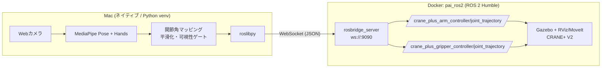

# PAI Final: Real-time Arm Mimicry（腕の動きをロボットアームにリアルタイム模倣）

Matsuo Lab Physical AI 応用編1 最終課題 / アカウント: 142124

デモ動画: https://youtu.be/WZooSJmVxc0

リポジトリ: https://github.com/physical-ai-learner26/pai-final-arm-mimic

## 概要
Mac のカメラ映像から MediaPipe Pose + Hands で人の**左腕**の姿勢と手の開閉を推定し、Docker コンテナ内の ROS 2 Humble 上で動くシミュレーションロボットアーム **CRANE+ V2**（Gazebo）にリアルタイムで模倣させます。Mac とコンテナ間は rosbridge（WebSocket, port 9090）経由で通信します。

## アーキテクチャ

```
[Camera] -> [MediaPipe] -> [mapping/smoothing] -> roslibpy ==WS:9090==> rosbridge -> JointTrajectory -> Gazebo(CRANE+)
```

## 必要環境
- macOS（内蔵カメラまたは USB カメラ）
- Docker Desktop
- イメージ: `airobotbook/ros2-desktop-ai-robot-book-humble`（コンテナ名 `pai_ros2`、noVNC: http://localhost:6080 , user/pass: `ubuntu`/`ubuntu`）
- Python 3 venv: `mediapipe==0.10.14`, `opencv-python`, `roslibpy`

## セットアップ
### Mac 側
```bash
cd ~/pai_final
python3 -m venv .venv
source .venv/bin/activate
pip install mediapipe==0.10.14 opencv-python roslibpy
```
> mediapipe 1.0 系は `mp.solutions` を含まないため、0.10.14 に固定しています。

### コンテナ側（初回のみ・rosbridge が無い場合）
```bash
sudo curl -sSL https://raw.githubusercontent.com/ros/rosdistro/master/ros.key \
  -o /usr/share/keyrings/ros-archive-keyring.gpg   # 期限切れ ROS apt 鍵の更新
sudo apt update && sudo apt install -y ros-humble-rosbridge-suite
```
コンテナはポート 9090 と 6080 を公開して起動してください（例: `-p 6080:80 -p 9090:9090`）。

## 実行手順（3 ターミナル）
noVNC（http://localhost:6080）でコンテナのデスクトップを開きます。

**ターミナル1（コンテナ）: シミュレータ**
```bash
ros2 launch crane_plus_gazebo crane_plus_with_table.launch.py
```
**ターミナル2（コンテナ）: rosbridge**
```bash
source /opt/ros/humble/setup.bash && ros2 launch rosbridge_server rosbridge_websocket_launch.xml
```
**ターミナル3（Mac）: 姿勢推定 + 指令送信**
```bash
cd ~/pai_final && source .venv/bin/activate && python arm_mimic.py
```

## 操作方法
| 入力 | 動作 |
|---|---|
| 左腕を左右に振る | joint1（根元の旋回） |
| 腕を上げ下げ・前後に倒す | joint2（肩） |
| 肘を曲げる | joint3（肘） |
| 手首を曲げる | joint4（手首） |
| 左手を開く/握る | グリッパー開（-0.5）/ 閉（0.3） |
| `h` | ホーム姿勢に戻す |
| `q` | 終了 |

映像は鏡像表示です。`SIDE` で使う腕を切り替えられます（腕だけが映ると左右が判別できないため、肩から腰まで映してください）。左右・前後が逆なら `YAW_SIGN` / `PITCH_SIGN` を反転します。腕のランドマーク可視度が 0.7 以下になると `ARM LOST` を表示し、ロボットはその場で姿勢を保持します。

## 注意事項
- macOS では Docker にカメラを渡せないため、推定は Mac ネイティブで実行しています。
- iPhone の連係カメラ（Continuity Camera）が優先されることがあります。カメラ番号を確認してください。
- JointTrajectory の header.stamp は 0 にしています（Mac の時刻を入れるとコントローラが指令を無視するため）。
- 前後の動きは MediaPipe の world 座標（単眼推定）で判定しており、精度には限界があります。CRANE+ にはひねりの関節がないため、腕のひねりは再現しません。
- MediaPipe の学習済みモデルを推論のみに使用しています（追加学習なし）。
